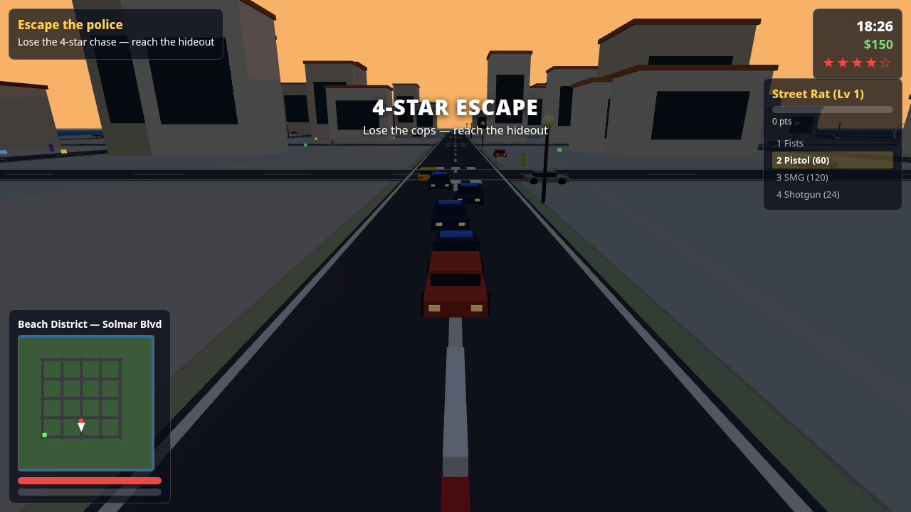

# Solmar — a 3D open-world crime game

**Solmar** is a 3D open-world crime game that plays in a desktop browser
from static files — no network, no install. You are **Dani Vega**, a
newcomer trying to become **King of Solmar**, a sun-soaked coastal city
on an island, with a beach, a harbour and marina, a lighthouse on the
headland, and a bridge over the harbour channel.

## How to play

Open `game/index.html` in a desktop browser (or serve the `game/`
folder with any static server). Click **START**.

- **W A S D** move (relative to the camera) · **Mouse** orbit the camera
- **Shift** sprint · **Space** jump (on foot) / handbrake (driving)
- **F** punch · **E** enter / leave a car · **Click** shoot
- **1–4** weapons (fists, pistol, SMG, shotgun) · **C** camera near / far
- **H** horn · **M** full map · **L** mission list · **N** mute · **Esc** pause

## The city

A road grid of five avenues and five streets, with districts of their
own: downtown with warm terracotta roofs, a beach district with pale
pastel roofs along the sand, a market quarter with brick roofs, hills
with slate roofs, and a marina and harbour district with boats in the
water. One block in six is a park with trees. A boardwalk runs along
the beach, a pier reaches into the sea, and the lighthouse watches over
the harbour. The day advances slowly from a golden late afternoon;
street lamps turn on as evening falls.

## Cars, police, and the law

Nine car models to steal and drive — from the humble Pinto to the rare
gold Strider and the Raptor — each with its own speed and handling.
Cars take damage, smoke when badly hurt, and a wrecked car must be
repaired at Marlowe Motors. About 30 traffic cars and 48 pedestrians
share the roads. Stealing, shooting and hitting pedestrians raise your
wanted level from 0 to 5 stars: cruisers chase and ram you, roadblocks
appear at 4 stars, and a police helicopter circles at 5 stars. Stay out
of sight to cool down.

## Story: 12 missions in 3 acts

- **Act I — New in Town:** meet the contact at Marlowe Motors, steal
  a car for the garage, run a timed drop, and fight the Breakers on the
  boardwalk.
- **Act II — Rising:** a timed taxi job for Rosa, a three-stop courier
  run, stealing the gold Strider from the harbour, and the Solmar Score
  — hold up the bank, then escape a 4-star chase.
- **Act III — King of Solmar:** a night shipment run, refusing Marco
  Vane's offer at the marina, the fight on the docks, and the finale —
  escape a 5-star chase to the hideout and take the crown.

## Side jobs and rank

Repeatable taxi fares (with a tip for speed), 12 hidden packages worth
$50 each ($500 bonus for all of them), and 5 stunt jumps worth $100.
Everything earns rank points on the ladder Street Rat → Wheelman →
Hustler → Made → King of Solmar. Reaching Made unlocks a gold Sunset
car parked by the marina.

Progress (money, missions, kills, fares, packages, jumps, rank) is
saved automatically on this device.

## Sound

All sound is synthesized in the browser — engine hum, police siren,
gunshots, horn, skid screech, fare chimes, rank fanfares and a looping
music line. No audio files.

## Built with

Three.js (vendored under `game/vendor/`), plain JavaScript modules,
and the seeded world generator in `game/src/`. The world is generated
once from a fixed seed, so it is the same on every run.

## Screenshots

1. `1-chase.jpg` — a 4-star escape at sunset
2. `2-walk.jpg` — on foot in the market plaza
3. `3-drive.jpg` — driving over the harbour bridge
4. `4-mission.jpg` — the finale shootout on the docks
